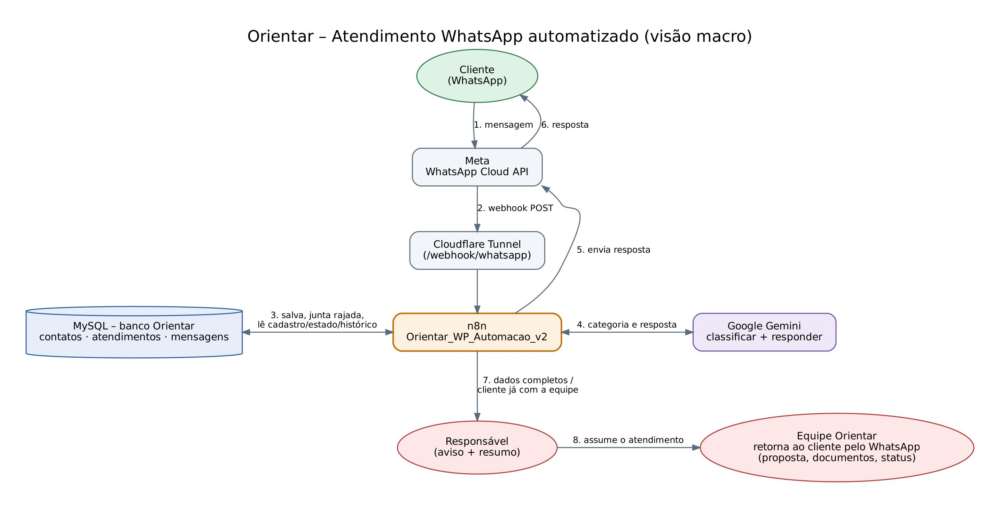
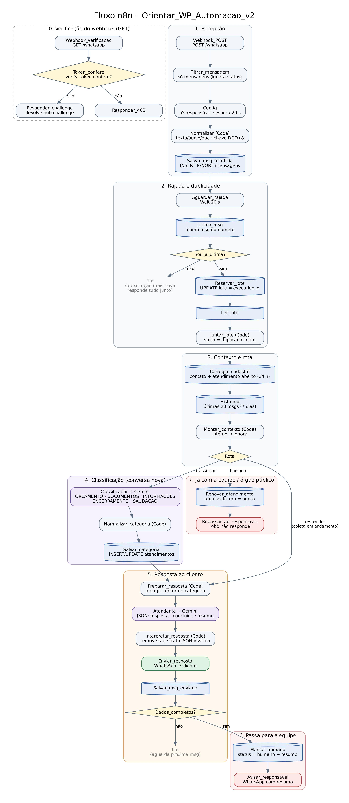
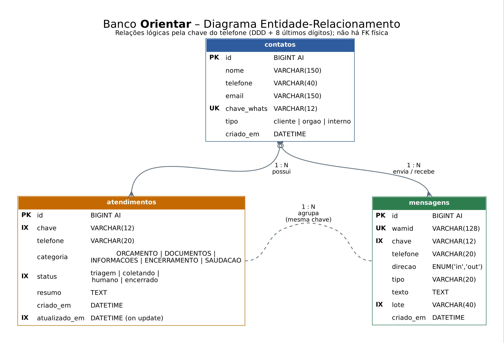

# Atendimento automatizado via WhatsApp – Orientar

Assistente virtual para o WhatsApp da **Orientar Soluções em Cartografia e Meio Ambiente** (Curitiba/PR), construída com **n8n**, **API oficial do WhatsApp (Meta)**, **Google Gemini** e **MySQL**.

A assistente recebe as mensagens dos clientes, identifica o assunto, coleta as informações necessárias e encaminha o atendimento à equipe com um resumo, reduzindo as interrupções das sócias durante os trabalhos de campo.

> Projeto de extensão do curso de Análise e Desenvolvimento de Sistemas.



## Funcionalidades

- Classifica cada conversa em **orçamento**, **documentos**, **informações**, **saudação** ou **encerramento**.
- Coleta os dados de cada tipo de atendimento, uma pergunta por vez, sem repetir o que o cliente já informou.
- Guarda o **estado do atendimento** no banco, para não reclassificar o cliente no meio da conversa.
- **Agrupa mensagens enviadas em sequência** e responde uma única vez.
- Descarta notificações duplicadas da Meta.
- Entende texto, botões, áudio, imagem, documento, vídeo, localização e contatos.
- Reconhece clientes cadastrados, órgãos públicos e equipe interna (a equipe é ignorada).
- Passa o atendimento para a equipe e avisa o responsável pelo WhatsApp, com resumo.
- Fica em silêncio por 24 horas após a passagem para a equipe, apenas repassando novas mensagens.
- Confirma que é assistente virtual quando o cliente pergunta diretamente.

## Estrutura do repositório

```
├── n8n/
│   └── Orientar_WP_Automacao_v2.json   # fluxo para importar no n8n
├── database/
│   ├── 01_criar_tabelas.sql            # cria as tabelas mensagens, atendimentos e contatos
│   └── 02_exemplo_contatos.sql         # contatos fictícios para teste
├── docs/
│   ├── Documentacao_Tecnica.docx       # todos os nós, campos e banco de dados
│   ├── Guia_Rapido_n8n.docx            # guia para usuários leigos
│   └── diagramas/                      # fluxogramas e diagrama ER (+ fontes Graphviz)
└── tools/
    └── vcf_para_sql.py                 # converte a agenda do WhatsApp (.vcf) em SQL
```

## Fluxo no n8n

O fluxo é dividido em 8 seções: verificação do webhook, recepção, agrupamento de mensagens, contexto e rota, classificação, resposta, passagem para a equipe e repasse de mensagens.

<p align="center"></p>

## Banco de dados



| Tabela | Finalidade |
|---|---|
| `contatos` | Cadastro de clientes, órgãos e equipe. `chave_whats` = DDD + 8 últimos dígitos do telefone |
| `atendimentos` | Categoria e status de cada atendimento (`triagem`, `coletando`, `humano`, `encerrado`) |
| `mensagens` | Histórico de mensagens recebidas e enviadas |

## Como instalar

### Pré-requisitos

- n8n (auto-hospedado) acessível por HTTPS
- MySQL 8+
- Conta no Meta for Developers com um app do WhatsApp Business (Cloud API)
- Chave de API do Google Gemini

### Passo a passo

1. **Banco de dados:** execute `database/01_criar_tabelas.sql` no banco `Orientar`. Para testar, execute também `02_exemplo_contatos.sql`.
2. **Importar o fluxo:** no n8n, importe `n8n/Orientar_WP_Automacao_v2.json`.
3. **Credenciais:** associe nos nós as credenciais de MySQL, WhatsApp e Google Gemini.
4. **Configurar os nós:**
   - `Token_confere`: troque `COLOQUE_SEU_VERIFY_TOKEN` pelo Verify Token definido no painel da Meta.
   - `Config`: informe o número do responsável (`55` + DDD + número) e o tempo de espera (padrão: 20 s).
   - Nós do WhatsApp: troque `SEU_PHONE_NUMBER_ID` pelo ID do número da empresa.
   - Nós Gemini: escolha o modelo.
5. **Ativar** o fluxo e cadastrar a URL `https://SEU_DOMINIO/webhook/whatsapp` no painel da Meta (Webhooks → campo `messages`).
6. **Testar** pelo navegador:
   ```
   https://SEU_DOMINIO/webhook/whatsapp?hub.mode=subscribe&hub.verify_token=SEU_TOKEN&hub.challenge=12345
   ```
   A página deve mostrar `12345`.

## Limitações conhecidas

- Áudios não são transcritos: a assistente pede que o cliente escreva.
- Arquivos enviados pelo cliente não são baixados, apenas registrados pelo nome.
- O aviso ao responsável depende da janela de 24 horas da Meta; para entrega garantida, use um template aprovado.
- Integração com e-mail ainda não implementada.

## Privacidade (LGPD)

Este repositório **não contém dados de clientes**. Contatos reais e conversas devem ficar apenas no banco de dados da empresa. O `.gitignore` bloqueia arquivos `.vcf`, `.csv` e exportações de contatos.

## Tecnologias

n8n · WhatsApp Business Cloud API · Google Gemini · MySQL · JavaScript · Graphviz
